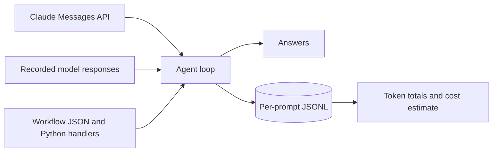

# Agent Harness

Agent Harness is a small Python runtime for tool-using agents. It records model responses and tool outcomes as JSONL, replays runs offline, and estimates token costs. Synthetic order management is the included workflow.

## Try offline replay

Install [uv](https://docs.astral.sh/uv/getting-started/installation/) and run these commands from the repository root. Replay uses the checked-in synthetic recordings and requires no API key.

```sh
uv sync --locked
uv run --locked python loop.py --replay tests/fixtures/orders-session
```

```text
I issued a simulated $25.00 refund for the mug.
The mug has already been refunded, so no additional refund was issued.
```

To replay a standalone prompt with several model requests, pass its JSONL file.

```sh
uv run --locked python loop.py --replay tests/fixtures/orders-single.jsonl
```

Replay runs the workflow’s tools on fresh local state and verifies the tool results and outcome of each prompt. The CLI prints answers on stdout and new trace paths, token counts, and estimated original costs on stderr. Replay incurs no model charges.



## Run interactively with Claude

Create a personal Claude API key in the console and scope it to your workspace. Live requests use your organization’s API billing or credits. [Claude Console API keys](https://platform.claude.com/settings/keys) · [Claude API key guide](https://platform.claude.com/docs/en/get-api-key)

With zsh, enter the key at a hidden prompt. You can also have your credential manager set `ANTHROPIC_API_KEY`.

```zsh
read -rs 'ANTHROPIC_API_KEY?Anthropic API key: '
printf '\n'
export ANTHROPIC_API_KEY
uv run --locked python loop.py --workflow orders
```

Ask `Please refund the mug from order ORD-1001.`, then `Please refund it again.` Type `exit` or press Ctrl-D to finish recording the session. To replay it, pass the directory containing both JSONL files and its `session.json` manifest, printed as the parent of each run trace path. A standalone prompt writes one file directly under `runs/`.

```sh
uv run --locked python loop.py 'Please refund the mug from order ORD-1001.'
```

The defaults are `--workflow orders` and `--model claude-haiku-5-5`. Live sessions retain completed conversation turns and local tool effects across prompts. Each prompt has an eight-request budget. Keep live trace data local, and use synthetic inputs for recordings you intend to share.

## Add a workflow

Use the [order workflow definition](workflows/orders/workflow.json) as the format for a workflow ID, version, display name, system prompt, and tool schemas. Implement a Python factory that opens fresh workflow state and returns a handler for each advertised tool. Handlers return a JSON payload and an explicit error flag. Register the definition and factory under their ID and version in the [workflow catalog](workflows/__init__.py). The CLI selects the latest registered version for live runs and the recorded version for replay.

The [V0.2 design](designs/v0.2.md) documents trace fields, replay rules, and pricing. See the [architecture and roadmap](designs/architecture.md) for later milestones.

## Run the tests

```sh
uv run --locked python -m unittest discover -s tests -v
```
