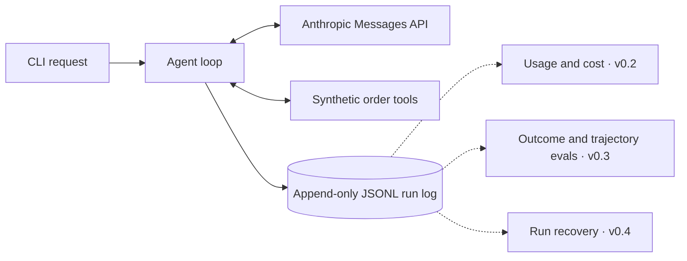

# Agent Harness Architecture

Agent Harness is a small Python runtime that shows which tools an agent called, how much the run cost, and how execution can recover after a crash. Its online store example looks up orders, cancels pending orders, and refunds eligible items using synthetic data.

## Runtime and run history

The [v0.1 design](v0.1.md) starts with a synchronous loop using the Anthropic SDK directly. The loop owns the conversation and dispatches a fixed set of order tools. It preserves the assistant’s content blocks and returns all tool results from a turn in one user message. A turn limit bounds the interaction.

In v0.1, each log is a trace of one run. The live conversation and fixture state are held in memory. Appending events preserves their order and gives later milestones a common record for usage, tool trajectories, and recovery. v0.4 adds the durability guarantees and event data required to reconstruct execution state from that history. The tool ledger records the actual refund effects and supports reconciliation when the run trace has an incomplete write.

Keeping the first loop direct makes the provider protocol, tool dispatch, and stop conditions visible in one place. Introduce a narrow provider interface when recorded responses need it. A neutral message model can wait for a second live provider, and a tool registry can wait for another example or a need for shared policy metadata. The local log and refund ledger keep the later recovery mechanism small enough to demonstrate without a workflow server.

## Milestones

| Version | Deliverable | Acceptance |
| --- | --- | --- |
| v0.1 | Anthropic loop, three order tools, a turn limit, and per-run JSONL | One synthetic support request completes from the CLI and leaves a readable trace. |
| v0.2 | Recorded-response replay, offline CI, per-run token and cost totals, and a README diagram | Public release after the publication review. CI runs without model credentials or provider network access. Usage totals come from response events and cost uses a dated model price table. |
| v0.3 | Ten retail eval cases with deterministic answer and tool-trajectory checks | One command reports pass rate and cost. Cases cover successful actions and policy rejections, and scorers check tool order and forbidden calls where relevant. |
| v0.4 | Bounded provider retries, human approval for large refunds, resume, and at-most-once refunds | Kill the process after a synthetic refund is committed and before its tool result is recorded. Resume the run and verify that the ledger contains one refund. |

## Recovery in v0.4

The harness records the approval decision for a gated write and makes a tool-intent event durable before dispatch. The intent carries a stable key generated by the harness. A synthetic refund records that key and the refund outcome in the same transaction in a persistent SQLite ledger. The harness then appends the tool result to the run log.

Resume reconstructs the conversation from recorded model responses and tool results and continues from the last complete step. An intent without a result means the outcome is uncertain. For refunds, the harness reconciles by querying the ledger with the original key and records any recovered outcome. If reconciliation cannot establish an outcome, it stops with `needs_human`. Tools with a downstream deduplication guarantee can retry with the original key. Provider retries are bounded and logged separately from tool execution.

The later backlog includes OpenTelemetry, additional providers, MCP, compaction, repeated eval trials, and judge calibration. The example stays on synthetic store data throughout these milestones.
